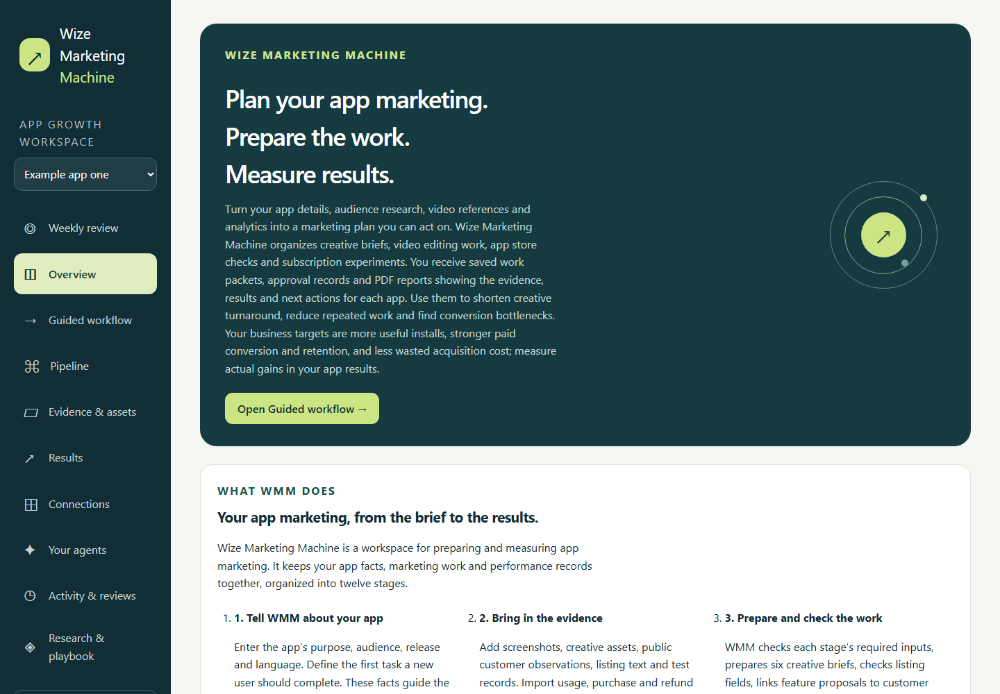
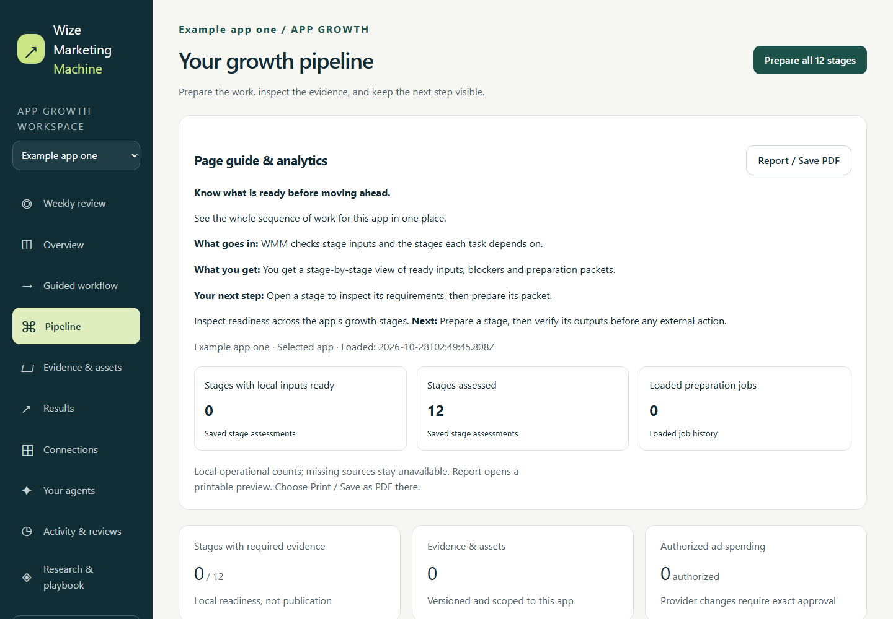
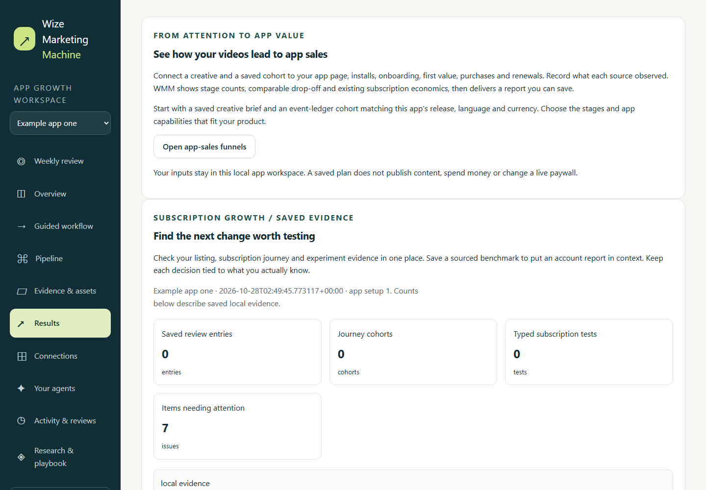

# Wize Marketing Machine — App Marketing & Growth Workspace

Research your audience, prepare creative work and review app growth evidence in one local workspace. **Wize Marketing Machine (WMM)** turns app facts, research references, media and analytics into saved marketing packets, creative briefs, app store checks, subscription experiment plans and PDF reports.

## What WMM does for you

1. **Collect:** app details, audience research, approved claims, media and results from imports or supported analytics connections.
2. **Prepare:** follow the twelve-stage app marketing workflow, revise creative work, validate ASO copy and define paywall or offer experiments. Users and compatible agents share scoped approval controls.
3. **Review:** inspect saved outputs, execution records and experiment evidence. Export PDF reports and see what needs attention next.

Use it for app marketing research, app store optimization (ASO), video marketing workflows, subscription experiments and marketing analytics. Results describe recorded evidence; they do not promise installs or revenue.

**[Explore the visual product overview](docs/index.html)** · [Connect your agent through CLI or MCP](docs/agent-quickstart.md)

## Potential outcomes for your team

- **Faster research-to-creative turnaround:** compare time from idea to reviewed brief or creative.
- **Less duplicated effort:** reuse app context, sources and prior decisions; track rework hours.
- **Better funnel decisions:** examine paywall, trial, paid conversion, renewal and retention evidence to locate where users drop off.
- **More disciplined acquisition:** compare compatible cost and cohort evidence to decide which experiment to continue, revise or stop.
- **Accountable delegation:** connect an agent, define its authority, then inspect approvals and saved results.

The business targets are more useful installs, stronger conversion and retention, and less wasted acquisition cost. These are potential outcomes to measure in your app, not guaranteed gains or results established by WMM's demo data.

## See the workspace

Actual WMM screens captured using synthetic example data in an isolated local database. These are product demonstrations, not customer campaign results.







## Start locally

Install **Python 3.11 or newer**, clone this repository, and run:

```powershell
git clone https://github.com/zrk222/WMM.git
cd WMM
python -m venv .venv
.\.venv\Scripts\python.exe -m pip install --require-hashes --only-binary :all: -r requirements.txt
.\.venv\Scripts\python.exe -X utf8 -m mission_control.server
```

Open **http://127.0.0.1:8765/**. On Windows you can also right-click
`mission_control/launch.ps1` and run it with PowerShell. It creates a private
Python environment and installs the hash-pinned timezone data automatically.
First setup needs internet access. No API key, paid account, Node.js or cloud
service is required for the core workspace.
Stop the foreground server with Ctrl+C. Data persists on your machine.

Windows is the supported platform for protected credential connections and
native agent discovery. The core server uses Python's standard library plus
the declared IANA timezone data package;
macOS/Linux protected credential and native CLI integrations are not supported
by this release. Do not deploy this workstation server to a public host or
expose it through a reverse proxy. It intentionally binds only to loopback.

To use another port or choose a local database location:

```powershell
.\.venv\Scripts\python.exe -X utf8 -m mission_control.server --port 8766 --database ./data/workspace.sqlite3
```

## CLI and MCP access

Both adapters live in this repository. From its root, using the Python
environment selected for WMM:

```powershell
python -m mission_control.agent_cli catalog
python -m mission_control.agent_setup --origin http://127.0.0.1:8765
```

The first command discovers current operations offline. The second reports the
selected interpreter and optional MCP dependencies, and prints a scoped-grant
MCP host configuration with absolute paths. Use your actual WMM port. It does
not contact WMM, install packages or register a host.

Open **Your agents → Connect your agent through CLI or MCP** for the running
origin and grant setup. Follow the [agent quickstart](docs/agent-quickstart.md)
for a usable call, optional MCP setup, authority modes and recovery. These
module commands do not require a globally installed `wmm` executable.

## First campaign workflow

1. Use **Add an app**, or edit one of the clearly labeled example workspaces.
   Enter its consumer job, audience, release, website and useful activation.
2. Follow **Workflow** and **Pipeline**. Each of the twelve stages explains its
   deliverable, missing inputs and acceptance checks. Unknown inputs stay unknown.
3. Add real evidence in **Evidence & assets**. Preparation creates saved stage
   packets; it does not publish campaigns or prove product readiness.
4. Optionally connect an agent in **Your agents**. Inspect its exact proposed
   context and operation, approve it, then review the draft and its sources.
5. Use the evidence-resolution actions to gather supported public observations
   or review a proposed remedy. Reuse is limited to current, matching evidence.
6. In **Results**, import actual cohort and retention evidence. Define an
   experiment before inspecting its results; retain uncertainty and guardrails.

No private app details, notebook research, customer records, account credentials
or operational databases are supplied. Example apps start unverified.

### Approve a plan and follow its progress

In **Pipeline**, choose **Review execution plan**. WMM proposes the available
evidence actions from the app's current gaps and connected sources. Remove any
actions you do not want, then approve the list. The local worker records each
result, continues independent approved actions after a failed check, and resumes
saved checkpoints when the service restarts. Keep WMM running for work to advance;
closing the browser does not cancel it.

Use **Inspect progress** to open the evidence or **Stop this plan** to cancel
remaining work owned by that plan. Reads started elsewhere are retained. Approval
expires after 30 minutes; changed app or source details can require fresh review.
An ended run means its approved actions were attempted, not that the campaign is
ready or published. Missing access leads to connection setup and another review.

### Inspect experiment tracking

In **Pipeline**, select **Inspect live tracking** for a registered experiment.
WMM derives the expected PostHog flag key, variant split and event scope. Review
the setup, then approve the read-only check. Its project, flag and aggregate reads
use the app's protected PostHog connection. Results and permission/setup failures
remain available under **Saved tracking reads**. Stop a pending check at any time.

The tracking review also offers a **browser integration package**. Its fixed
module, config, example and guide include source hashes for the exact app release
and experiment. Integrate it through the app repository's normal review process;
downloading is not installation. It wraps an existing PostHog client with current
consent and identified-user checks, fresh remote flags, same-origin IndexedDB
assignment state and stable assignment/exposure event UUIDs. SDK acceptance is
reported as **queued, not delivered**. DOM visibility is not proof of human
attention. Native adapters, cross-device state, concurrent-test interference and
a genuine provider pilot remain separate work.

The agent also proposes eligible tracking checks in **Review execution plan** and
the evidence-resolution choices. Review the exact experiment, source, project,
release, locale and observation window, then keep or remove actions before
approval. The worker records a native tracking receipt before the parent action
can finish. Dispatch and restart retain the original approval expiry. Stopping
the owning sequence also stops its active tracking checks. Missing setup, no
observations and permission failures remain resolution work rather than success.

The key needs project, feature-flag and query read access. No write permission is
used. Your app must separately implement the displayed assignment and exposure
event contract. Counts deduplicate provider distinct IDs; they do not establish
human views, complete instrumentation, conversion or causal lift. This release
does not create flags, install the SDK or launch an A/B campaign. Reads can repeat
under the existing worker recovery limit after an interruption; provider usage
limits still apply. See [PostHog experiments](https://posthog.com/docs/experiments).

## Capabilities and boundaries

| Capability | Included behavior |
| --- | --- |
| App registry | Versioned local manifests, isolated workspaces, snapshots |
| Twelve-stage pipeline | Readiness checks, missing-evidence remedies, durable preparation jobs |
| Approved follow-through | Editable finite evidence-action lists, saved checkpoints, cancellation and result links |
| Agent assistance | Supported native Codex/Claude discovery and BYOK setup, exact context review, saved drafts and typed action feedback |
| Analytics | Optional PostHog, Microsoft Clarity and RevenueCat aggregate reads using your authorized keys |
| Google Play | Guided Android package discovery, protected Desktop OAuth, queued release and subscription catalog reads |
| ASA / AEO | App-specific worksheets, public-site observations, source-bound recommendations |
| Creative work | Local assets, briefs, rankings; optional detected FFmpeg tools for supported rendering |
| Experiments | Local A/B plans, schedules, evidence evaluation and retained learning |
| Social connections | Guided Facebook, Instagram, TikTok and LinkedIn setup; requires your own developer apps, allowed scopes and provider approval |
| External changes | A narrowly supported App Store promotional-text action requires separate verified maker/checker review and exact final approval |

**This release is not a fully autonomous advertising or social publishing
service.** Broad campaign publication, autonomous spending and guaranteed growth
are not implemented. Preparing a packet or passing a local fixture does not mean
a campaign ran. Provider availability, permissions and API limits remain external
requirements. A model subscription is usable only through a supported installed
official CLI; it is not a general-purpose API entitlement.

## Optional connections

Use **Connections** to configure your own supported project IDs and authorized
server-side keys. Windows Credential Manager protects saved secrets, scoped to
the app and local database location. Never paste credentials into evidence,
campaign text, screenshots or Git. Connection tests do not install analytics SDKs
in the apps you promote. Automatic aggregate reads run only while WMM is running.

For social OAuth, see [callback relay setup](callback_relay/README.md). No shared
relay, developer app, login or provider account is bundled. Providers may require
review before granting scopes. Saved local authorization cannot bypass that.

### Let the agent collect app setup details

Save a public website in **App setup**, then choose **Discover app details**.
The agent reads that saved source through the robots-first public inspector and
creates a local draft. The same action is available in missing-evidence agent
resolution options. Agent job results link directly to the draft review.

Compare suggestions with saved values, edit as needed, check only the fields to
change and choose **Approve selected changes**. Conflicts remain explicit. Apple
Store IDs and Android packages are separate; confirm the Android track yourself.
Website claims and page language do not prove ownership, readiness or tested
locales. Release and activation evidence still need separate verification.

Drafts expire after one hour and become stale when app setup changes. Up to 64
drafts are retained per app; removing a draft preserves app details, connections
and audit history. Missing or denied sources offer retry, edit, connection and
evidence paths. No private login, publication or spending is performed.

### Google Play setup

In **Connections → Google Play**, review the exact Android package and Play
track. You can import an `app.json`, `AndroidManifest.xml`, `build.gradle` or
`build.gradle.kts`; WMM reads explicit metadata without executing the project.
Confirm build variants yourself. Android identity stays separate from the
numeric Apple Store ID in App setup.

Enable the Google Play Developer API in your own Google Cloud project, create
a **Desktop app** OAuth client and select its downloaded JSON file. The account
must have permission for the target app in Play Console. WMM opens Google's
official consent URL with PKCE and returns to this running instance's actual
loopback port. Keep WMM running until verification finishes. The required
`androidpublisher` scope is broad; WMM's adapter permits only these two read
operations, and cannot limit the scope Google grants. Restrict app access in
Play Console. No shared OAuth client or Google account is included.

A successful release read is required before the protected connection replaces
existing access. Read releases or the subscription catalog from the panel;
dated observations, queued jobs, errors, retry and reconnect controls remain
available. Windows Credential Manager holds the client and refresh grant.
Access on macOS/Linux is not implemented; there is no plaintext fallback.

Release inventory excludes obsolete releases and does not prove country
availability, rollout fraction or store readiness. Catalog reads do not test
localized checkout, purchase or restore. Install Referrer, Android attribution
and Google Play publication are separate, unfinished integrations. Automated
tests simulate Google consent and responses; they do not verify your live app.

Optional security/audit tools must already be installed and detected. They are
not downloaded or executed merely by starting the core application.

## Local data and recovery

The default database is `mission_control/data/mission-control.sqlite3`; uploaded
files live beside it. Keep this directory private. Back it up with WMM stopped,
including its associated files. The UI also offers per-app JSON snapshots;
restored snapshots do not restore credentials, verified roles or execution
authority. Reconnect and reauthorize on the new installation. Never replace a
live database with an older snapshot without preserving the current copy.

This is a trusted-workstation application, not multi-user hosted authentication.
Loopback, Host checks, HTTP-only sessions, CSRF checks and a restrictive content
policy are enabled. Do not disable them to expose the app remotely.

## Development checks

```powershell
.\.venv\Scripts\python.exe -X utf8 -m unittest discover -s tests -p "test_*.py"
.\.venv\Scripts\python.exe tools/check_distribution.py
```

Tests use synthetic data and temporary databases. They do not make purchases,
publish posts or prove live provider integration. The full test profile also
requires FFmpeg and FFprobe on PATH and a supported Segoe UI font. These native
tools are optional for normal non-video use; the CI profile installs them.
See [release scope](RELEASE-SCOPE.md)
and [security guidance](SECURITY.md). Licensed under the [Apache License, Version 2.0](LICENSE).
