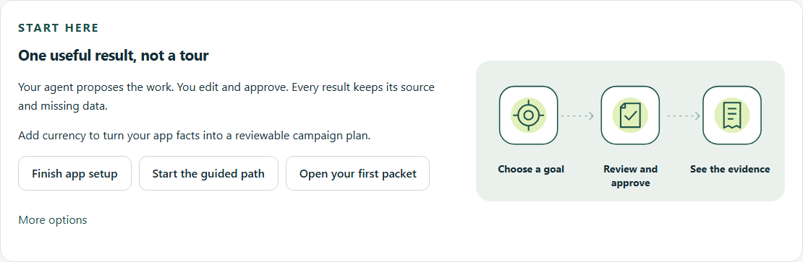

# Wize Marketing Machine

**Turn one app-growth question into an evidence-backed marketing experiment.**

Built for founders and marketing teams to promote and manage one app or a portfolio with personal AI agents. Set a goal, repair missing connections and review one Automation agreement. Your agents work within approved limits; each app keeps its own permissions, evidence and reports.

[**Install WMM and create your first packet**](docs/desktop-first-run.md) · [Try the interactive sample](https://zrk222.github.io/WMM/demo.html)

Free for personal and internal business use under the [license](LICENSE). [Commercial terms](docs/pricing.md).

**Day 1 — a clearer next marketing move.** Prepare a first evidence packet: one app-growth question, a plan, sources and missing evidence.

**Around Day 30, with regular use — a record you can build on.** Review dated research, approved work and available results; decide what to continue, revise or stop.

Potential benefits: less repeated research and clearer decisions. Measurements depend on available data; growth and time savings are not guaranteed.

*Actual WMM screen with synthetic example data. [Visual tour](https://zrk222.github.io/WMM/).*

## From goal to decision

1. **Set your goal.** Pick research, creative, a campaign or measurement. Readiness shows missing setup and repairs.
2. **Approve the boundaries.** Review one revocable permission slip: app, agent, accounts, content, destinations, schedule, expiry, quotas, budget and stop rules. By default, nothing publishes or spends on its own; effect-specific approvals still apply.
3. **Watch the work.** Follow approved jobs, receipts and recovery. Unknown delivery stays unresolved for review, never blindly replayed.
4. **Review results.** Inspect source-backed observations, export a report and choose Continue / Stop / Revise. Advanced tools remain available.

## What you can do

| Goal | WMM tools |
| --- | --- |
| Find a creative angle | Research Facebook, Instagram Reels, TikTok and YouTube Shorts. Viral qualification requires **100,000 observed views and 10× the creator’s documented baseline**. |
| Make or revise creative | Build an evidence-linked brief; upload or select Drive media; edit, stitch and review a captioned video. |
| Run an approved campaign | Schedule approved Facebook batches with recovery, monitoring and reports. Reviewed organic paths cover Instagram, TikTok, YouTube Shorts and LinkedIn; paid work remains bounded Meta engagement campaigns. [Channels and account requirements](docs/agent-multichannel.md). |
| Measure app growth | Retain observations, failed experiments and CAC/ROAS where inputs support them. Missing metrics stay explicit; engagement is not installs, revenue or lift. |

[WizeMe dogfooding: dated operations and evidence](docs/WIZEME-DOGFOODING.md) · [Current release scope](RELEASE-SCOPE.md). Measured growth and time savings are not yet established.

## Run WMM

The [desktop preview](docs/desktop-first-run.md) includes the runtime on Windows and Ubuntu. The Windows preview is unsigned. Current source updates can precede the published installer; check its release notes. For scheduled work while your computer is off, use an [optional private host you control](docs/always-on-runtime.md). The [native iPhone/iPad app](ios/) has separate acceptance limits.

Connect a [local CLI or MCP assistant](docs/agent-quickstart.md). Use [operating profiles](docs/personal-agent-operations.md) for Grok Bot, Meta Muse, Codex/Dots, Claude and other assistants. Remote access needs an authorized workspace connection.

Run from source with Python 3.11+

~~~sh
git clone https://github.com/zrk222/WMM.git
cd WMM
python -m pip install --require-hashes --only-binary :all: -r requirements.txt
python -X utf8 -m mission_control.server
~~~

Open http://127.0.0.1:8765/. Keep the server on loopback. Core use needs no model API key; connected accounts and media workflows have separate prerequisites.

[Workspace guide](docs/workspace-guide.md) · [Contributing](CONTRIBUTING.md) · [Maintainability contract](docs/MAINTAINABILITY.md) · [Test profiles](docs/TESTING.md) · [Security](SECURITY.md)
