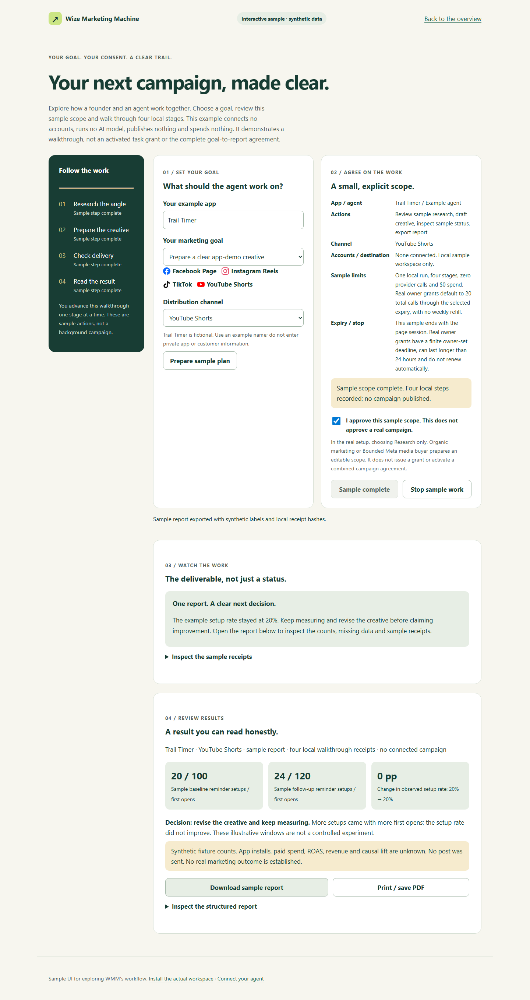
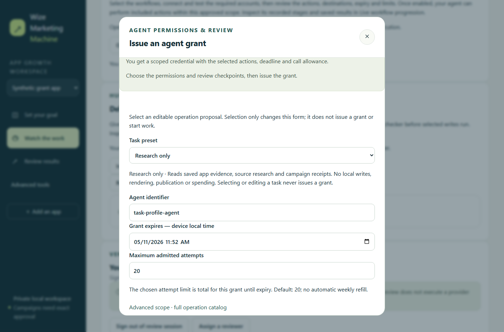
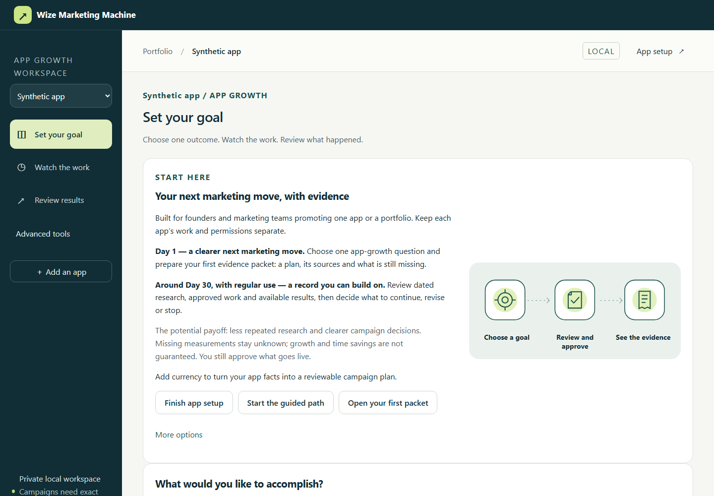
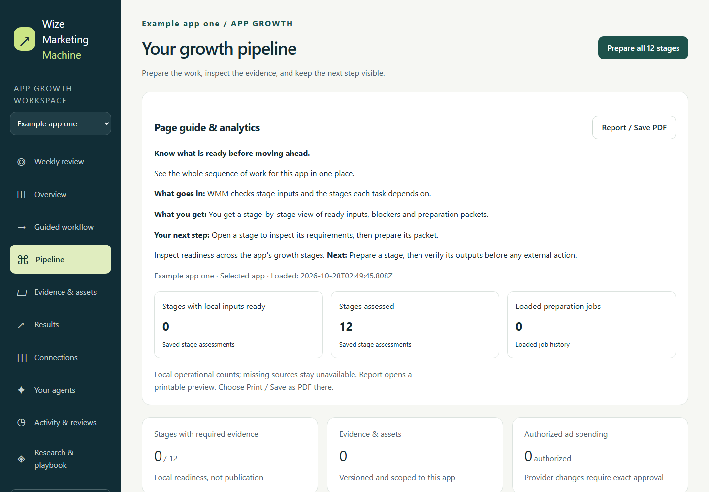
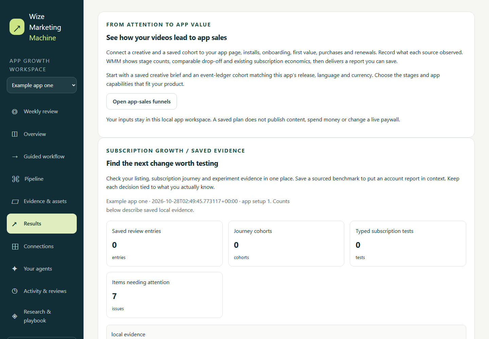

# Wize Marketing Machine

**A calmer way to market your app — with receipts.**

You built the app. Now you need people to find it, try it and come back. The research, creative, campaign work and results should lead to one clear next move.

Wize Marketing Machine (WMM) is a local workspace for one app at a time. It helps you plan the work, keep the evidence and see what actually happened. An AI assistant can do approved steps inside limits you set; nothing publishes or spends on its own.

**You choose the goal and approve each permission slip. Your assistant works inside it. You get the files, the receipts, the measurements and one next decision.** A permission slip is a time-limited list of actions for one app. You can edit it, set its expiry and call limit, and revoke it.

[**Try the sample workspace**](https://zrk222.github.io/WMM/demo.html) · [See the visual tour](https://zrk222.github.io/WMM/) · [Install WMM](docs/desktop-first-run.md)

*A working interactive example with synthetic data. It connects no accounts, publishes nothing and spends nothing. Try it in your browser, or open `docs/demo.html` after downloading the repository.*

*Starter task presets prepare a permission slip you can edit before approving.*

## A simple path from “market my app” to a decision

1. **Set the direction.** Describe your app, audience and outcome. Bring research, clips and your own supported accounts.
2. **Choose how much to delegate.** Start with Research only, Organic marketing, Bounded Meta media buyer, or Custom. WMM prepares a list of allowed actions for you to review. Edit it, then approve a permission slip with an expiry and a call limit. Approve exact content and destinations before any reuse or publishing. Paid Meta activity needs its own campaign approval for account, content, targeting, expiry and budget.
3. **Follow the work.** While a permission slip is active, your assistant can research, prepare creative and carry out supported work within its limits. Watch progress and decide what needs attention.
4. **Open the report.** See the files, what ran, dated measurements and receipts. Choose what to continue, revise or stop.

Each permission slip has an expiry you set and does not renew by itself. The default allowance is 20 calls. Advanced settings show every supported action individually.

## Research ideas across four channels

Through a permitted connected assistant, research metadata for **Facebook Page, Instagram Reels, TikTok and YouTube Shorts**. Viral qualification requires **100,000 views AND 10× a documented creator baseline**. Save source evidence, build a brief, prepare a short captioned video preview and export approved artifacts.

**Approve the post. Let your assistant carry it through.** WMM queues approved Facebook Page posts, Instagram Reels, TikTok videos, YouTube Shorts and LinkedIn text/video posts, then keeps the provider IDs, status reads and available engagement counts together. Each channel uses its official publishing permissions and account setup. Open **Connections → Publish an approved post** to review content, destination, rights and timing before queueing. [Publishing guide](docs/agent-multichannel.md) · [Interactive sample](docs/demo.html).

In WMM: **Set your goal → Explore video channels → Find viral ideas for my app.**

The intended payoff is less coordination, faster creative cycles and better decisions about installs, activation, paid conversion and retention. Analytics retain source dates, definitions and missing data; receipts show what was actually done. Measure the benefit on your app—growth and time savings are not yet established by the dogfooding trial.

**Available today:** local workspaces, optional assistant access through a local command or MCP, creative and evidence tools, supported analytics paths, reviewed organic distribution across five networks and bounded Meta engagement campaigns. Shared team dashboards, additional paid-ad networks and complete KPI coverage remain in development; the team-tier architecture is [proposed here](docs/adr/0001-team-tier.md), and scope stays narrow until [verified value](docs/adr/0002-stay-narrow.md). [Current tools and limits](#what-is-included-today).

[Follow the WizeMe dogfooding journey](docs/WIZEME-DOGFOODING.md): dated operations, verified receipts and the next measurement step.

## What is included today

| Your job | WMM’s working tools |
| --- | --- |
| **Organize the app** | Separate app workspaces, versioned facts, the twelve-stage pipeline, readiness checks, next actions, history and noncredential snapshots. |
| **Find useful creative references** | App-scoped discovery queries, industry/narrative/treatment filters, saved collections, source snapshots, watch attempts and evidence cards that feed creative briefs. Viral-only qualification requires **100,000 views AND 10× a documented creator baseline**. Uploaded UGC follows its own intake path. |
| **Choose the packaging before production** | Title and thumbnail concepts, creator-relative outlier research, remix workspaces, feed previews, creative taste guidance and review checklists. A preview is a design check, not a measured performance prediction. |
| **Make and revise content** | Eight-piece copy packs; local and selected Google Drive media; UGC and clip intake; timeline editing, trimming, ordering and stitching; human/agent edits and history. Built-in caption renders create timed title/caption scenes; the editor handles richer projects. Preflight checks timing, text density and prerequisites; explicit verified-render reuse avoids queuing a new build. |
| **Improve the app’s sales journey** | ASO, ASA and AEO worksheets, store/listing checks, funnel plans, paywall/offer experiments, cohorts, event/billing imports and experiment assessments. App Store promotional text has its own maker/checker approval path. |
| **Collect and understand results** | Supported App Store Connect, Apple Ads, Google Play, PostHog, Clarity and RevenueCat paths, plus imports. Coverage varies by source and platform. Reports retain dates, definitions, denominators and missing data; PDF and data exports support review and handoff. |
| **Execute supported campaigns** | Facebook Page posts, Instagram Reels, TikTok videos, YouTube Shorts and LinkedIn text/video: review the post and destination, approve a bounded allowance, queue it and inspect the receipt. Interrupted writes stay held for reconciliation. Available engagement counts are retained; installs and revenue need their own tracking. Paid execution remains bounded Meta engagement campaigns. |
| **Delegate and monitor** | CLI/MCP operations, app-scoped grants, manual or bounded autonomous work, approval checkpoints, progress, durable jobs, cancellation and recovery. Missing source analytics stay marked as missing; they are not evidence of growth. Provider-reported token/cache usage stays separate from estimated cost. |

[Campaign controls and limits](docs/campaign-automation.md) · [Video-caption production guide](docs/hypit-production-preflight.md) · [Assistant workflow upgrades](docs/personal-agent-upgrades.md)

## Optional: connect an AI assistant

WMM gives an assistant a clear, limited way to work: inspect the app and permissions, reuse current evidence, stay inside the limits, verify the saved result and report back. It works with any assistant that can run a local command or MCP connection; no specific product or plan is required.

A cloud assistant cannot reach another computer’s localhost. Each host still needs a verified way to run on this computer; the setup guide supplies instructions, not connectivity or account permission. [Assistant setup and owner reports](docs/personal-agent-operations.md).

Named setups (optional)

Named profiles for **Grok Bot, Instinct, Hark Pro, Meta Muse, Codex/Dots and Claude Duet**, plus generic agents and agent teams, share one protocol. For Grok Bot specifically: verify a separately approved local command connection, keep the repeatable method in a private skill, use scoped permission slips, retain request IDs and serialize changes to the same resource.

Try this first task:

> Read my app and current permissions. Find the next useful marketing action, prepare its deliverable and ask only for decisions outside your approved scope. Report what you completed, link the evidence, show what remains unknown and recommend one next step. Do not publish or spend without the exact campaign authority.

## See WMM working

Actual screens with synthetic example data—not customer campaign results.

See the pipeline and analytics screens

## Start with the desktop app

[Install WMM and make your first useful marketing packet](docs/desktop-first-run.md). Windows and Ubuntu preview installers include the runtime; Python is not required. The guide identifies the current installer downloads, private data locations and first task. For unattended work, choose the [optional owner-managed always-on host](docs/always-on-runtime.md).

## Start from source

Install **Python 3.11+**, clone the repository and run:

~~~sh
git clone https://github.com/zrk222/WMM.git
cd WMM
python -m pip install --require-hashes --only-binary :all: -r requirements.txt
python -X utf8 -m mission_control.server
~~~

Open **http://127.0.0.1:8765/**, add one app and prepare one evidence packet. A private virtual environment is recommended; [Windows/Linux setup, optional tools and recovery](docs/workspace-guide.md) cover the details. Core use needs no model API key or paid service. Provider and video workflows need their own prerequisites.

**Platforms:** protected desktop credentials use Windows Credential Manager or a configured Linux/Ubuntu Secret Service. The desktop macOS credential adapter is unsupported. The separate [native iPhone/iPad app](ios/) uses on-device Keychain and media execution; see its current acceptance limits rather than assuming desktop parity. Keep the desktop server private on loopback.

**Your accounts stay yours.** Bring your own supported keys/OAuth or installed official agent CLI. A subscription is not a general API entitlement. Snapshots do not carry credentials or execution authority. Default ad spending is zero; an enabled campaign needs a separate exact owner scope. Media limits exclude provider taxes, fees and currency effects. Live provider behavior and business gains require actual account evidence.

## License and development

Free personal evaluation and internal business use under the [WMM Personal and Internal Business Use License](LICENSE). Resale, hosting, white-label products and paid external-client services require a separate commercial agreement. [Pricing and commercial path](docs/pricing.md) · [Prior Apache grants and third-party rights remain preserved](docs/licensing.md).

[Development checks](docs/workspace-guide.md#development-checks) · [Release scope](RELEASE-SCOPE.md) · [Security guidance](SECURITY.md)
