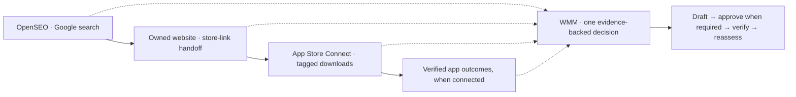

# Search to App Store review

## Owner outcome

In **Review results → Search to App Store**, show the strongest supported insight and recommend one action WMM can prepare or execute. Give the owner the evidence, decision criteria, guardrails and follow-up date before approval. Keep existing analytics, pipeline and campaign controls available for drill-down.

The goal is sustained qualified acquisition. An owner selects a primary metric for each test. Relevant upstream and downstream signals remain visible as guardrails, so a gain in impressions alone cannot count as success when it harms the outcome the owner cares about.

## Default view

| Order | What the owner sees                                                                                                                                                                                                                 |
| ----- | ----------------------------------------------------------------------------------------------------------------------------------------------------------------------------------------------------------------------------------- |
| 1     | **What we learned.** The conclusion, its evidence strength, and the unresolved question that matters to the decision.                                                                                                               |
| 2     | **What WMM proposes next.** One exact page, audience, change, primary metric, baseline, guardrails and review criteria. Show the earliest valid check or the prerequisite that must be resolved first.                              |
| 3     | **Follow the evidence.** Google search, the website handoff and the App Store each show their own counts, scope, observation dates, freshness and source receipt. Display product outcomes when the app supplies a verified cohort. |
| 4     | **Follow-up.** Show what WMM prepared, what needs approval, what ran, how it was verified, and when the next check is due.                                                                                                          |
| 5     | **Export.** The PDF and JSON record the same insight, figures, uncertainties, action, guardrails and receipts visible on screen.                                                                                                    |

Use a single column on narrow screens. Keep the recommended action and evidence status above the fold. Use text labels for source states. Give source and comparison tables keyboard navigation and explicit headings. Screenshot or PDF evidence must retain the app, scope, dates and source status.

The first four boxes are observation stages. A stage can support its own conclusion when another stage is missing. Arrows between providers describe the proposed customer path. WMM claims cross-stage attribution only when the corresponding delivery and outcome receipts support it.

## Sources and comparison rules

| Evidence          | Reuse                                                                                       | Report rules                                                                                                                                                                                                                                                                                                                                                                                    |
| ----------------- | ------------------------------------------------------------------------------------------- | ----------------------------------------------------------------------------------------------------------------------------------------------------------------------------------------------------------------------------------------------------------------------------------------------------------------------------------------------------------------------------------------------- |
| Google search     | Native OpenSEO through `openseo_read.py` and retained `WEB_SEO_EVIDENCE` in Growth Reviews  | Current native read is final web-search data for one site and country, 28 days ending four days before retrieval, at most 20 page or opt-in query/page rows. Preserve omissions and dates. Google clicks, impressions and CTR use the same comparable source slice. An OpenSEO read and a direct Search Console export can represent the same upstream dataset.                                 |
| SEO opportunities | Existing scoped OpenSEO imports and source precedence                                       | Index findings, audits, rank, keyword estimates and competitor research can identify hypotheses or technical repairs. Keep provenance visible. Paid research stays outside the default run.                                                                                                                                                                                                     |
| Website handoff   | Existing owner-approved analytics binding and GA4 or app-owned event evidence               | Require an explicitly defined store-link event whose destination resolves to the exact product. Use eligible organic sessions and store-bound **sessions** at the same grain when calculating a rate. Imported operator evidence carries its own label until verified.                                                                                                                          |
| Apple activity    | Existing private Apple analytics routes, report worker, reconciliation and daily partitions | Keep report family, app ID, event dates, processing dates, source hashes and explicit zero distinct from missing. Discovery normally takes three days and downloads two days to mature, subject to available files and corrections. Initial app-wide Apple figures stay app-wide. Show missing dates and provisional counts individually.                                                       |
| Apple attribution | Existing Apple campaign link validation and Detailed download result reader                 | An approved distinct website token, verified page-to-listing delivery and exact app, token hash, territory and event-date receipts can support first-time downloads attributed by Apple. Apple first-download attribution can follow the campaign link by up to 24 hours. Treat withheld or absent rows as unavailable. Keep the existing Meta post receipt requirement for social attribution. |
| App outcomes      | Existing consented first-party outcome and billing joins when verified                      | Compare activation, trial, paid and refunds only for a matched and mature cohort. Report source grain, coverage and exclusions.                                                                                                                                                                                                                                                                 |

Use only one reconciled observation per source key and event date. A newer Apple processing version replaces the older version. A future common-window comparison needs an actual day-grain Search Console read and Apple territory projection. Present each source with its own window until these exist. A 28-day aggregate cannot be split into daily results.

The Apple standard row event named `Impression` covers an app icon in a list and excludes page views. `Page view` may include app and in-app event pages. Use these exact distinctions in the current report. App Store Connect dashboard metrics have their own definitions, including unique-device denominators. Validate a dashboard-equivalent label against matching live data before using it. Keep raw row counts and Apple dashboard values individually sourced. Never derive a download rate by dividing app-wide Apple downloads by Google clicks or Google impressions.

Source states distinguish missing access, waiting for files, incomplete coverage, provisional evidence and measured value. A confirmed zero requires an observed zero in a valid source. A missing or potentially suppressed row remains unavailable. Where a provider does not identify the reason, show **Unavailable** and the next valid check rather than guessing.

## Choose one next action

Order decisions by the most consequential verified constraint. First resolve a broken destination or unusable measurement. Then address a measured bottleneck with an owner-approved experiment. Use estimated opportunities for research only when direct evidence is insufficient. Versions of the same source cannot count as independent corroboration.

| What the receipts show                                                                            | What WMM proposes to do                                                                         | How WMM checks it                                                                                                                                   |
| ------------------------------------------------------------------------------------------------- | ----------------------------------------------------------------------------------------------- | --------------------------------------------------------------------------------------------------------------------------------------------------- |
| The iOS link is absent, untagged or reaches the wrong product                                     | Draft a destination repair or instrument the existing link without changing its message         | Read back the exact link on the owned page, verify the App Store app ID and check the owner-approved aggregate event.                               |
| A relevant query/page pair has material exposure and weak CTR against its own comparable baseline | Draft one title or description change for the existing page                                     | Compare Search Console CTR over matched final windows. Watch position, eligible sessions and downstream store handoffs.                             |
| Measured organic sessions reach the intended page but the verified handoff rate is weak           | Draft one isolated iOS CTA change. Preserve the current useful web path as a guardrail          | Compare storefront-bound sessions per eligible organic session and check web starts. Review exact Apple-attributed downloads as a separate outcome. |
| Matched Apple evidence shows a persistent product-page opportunity                                | Draft one listing or product-page experiment, with the exact change and existing approval route | Evaluate the Apple experiment’s own eligible denominator and declared endpoint. Watch first downloads and the selected downstream guardrails.       |
| A verified, mature paid or activation cohort underperforms despite healthy acquisition            | Propose the smallest onboarding or pricing hypothesis WMM can prepare and route                 | Reuse the existing cohort and billing measure. Report refunds, paid conversion and contribution only with appropriate receipts.                     |
| Coverage is missing, incomparable, or too sparse                                                  | Propose one repair, wait for a mature source or hold the current action                         | Recheck at the earliest valid time and resume only after the required source and coverage are confirmed.                                            |

Every recommendation freezes its exact app, release, property, market, storefront, dates, source receipts, rule version, primary metric, expected direction, minimum sample, meaningful improvement, guardrails, cutoff and stop condition. The owner defines decision criteria before launch, using the measured baseline where available. If the baseline is unknown, WMM proposes measurement rather than a growth claim. Label a before-and-after result as descriptive unless the experiment supports a causal estimate.

## Proactive execution and ownership

1. **Observe.** Use existing authorized scheduled reads when the owner enables them. Evaluate the saved sources when evidence changes or a follow-up comes due. Keep provider auth and credentials in their current owner vaults.
2. **Prepare.** Save a deduplicated insight and one experiment draft in existing Growth Review and experiment storage. Include exact asset or URL changes. The same evidence and rule version renew the existing decision. New evidence can supersede it and invalidate stale drafts.
3. **Route.** WMM can prepare evidence, draft reversible changes, and schedule authorized checks. Apply external changes only through supported existing execution paths under the current owner agreement and any required exact approval. Website deployment may remain an owner task. Store writes follow their existing maker/checker controls. A research recommendation authorizes zero spend.
4. **Watch.** Use the existing worker and reports. Record provider readback where relevant, use durable source and action identities across restarts, and pause or stop through the owning workflow. Keep one unpublished recommendation per app and goal so routine polls do not multiply work.
5. **Review.** At the predeclared cutoff recommend keep, revise, stop or wait. Make regressions, broken measurement, approval drift and missing mature outcomes visible. Trigger a new test after a decision, using current evidence and approval.

Keep the protected Apple report action behind the existing fresh-owner gate. The general workspace response receives only permitted status. Reuse WMMPageReports for print/export and the existing web and Apple source contracts. Add a typed owned-page delivery receipt before showing SEO campaign attribution. Report actions carry no new publication authority.

## Delivery slices

1. Compose private results from the existing saved sources and publish the evidence-first panel and matching PDF. Include a single recommended measurement repair or evidence-backed test. Show known date and territory gaps before using cross-source comparisons.
2. Add an owner-approved website link receipt, a tag and exact campaign result comparison. Integrate the existing experiment draft, approvals, bounded refresh and exception reporting.
3. Add automatic recommendations after authorized reads, common-window and territory support where the sources allow it, and a verified app cohort view. Reuse the current scheduler, reconciliation and evidence stores.

## Acceptance

- With matching scoped receipts, the same dated figures and evidence appear on screen and in the exported report. Current raw Apple event labels match the provider glossary.
- With no usable reports, the owner sees a clear next repair and no numeric default or fabricated comparison.
- A valid zero, missing day, corrected file, provisional day and incomplete OpenSEO slice stay distinct across restart.
- A mismatched app, country, storefront, source version, token or date prevents the affected conclusion. Replaying inputs or retrying a run does not duplicate a draft, an external effect or an outcome.
- Measure each action against its registered outcome and guardrails. Validate desktop and mobile on synthetic fixtures, then compare a live scoped sample with the owner dashboards before claiming release or measured improvement.
- Fresh owner checks, export privacy, schedules, pause and approval revocation preserve existing authority boundaries.

## References

- [WMM OpenSEO integration](../docs/openseo.md)
- [OpenSEO tool catalog](https://openseo.so/docs/mcp-tools)
- [Apple discovery report fields](https://developer.apple.com/documentation/analytics-reports/app-store-discovery-and-engagement)
- [Apple dashboard metric definitions](https://developer.apple.com/help/app-store-connect-analytics/reference/metrics-definitions/)
- [Apple report completeness and corrections](https://developer.apple.com/documentation/analytics-reports/data-completeness-corrections)
- [Apple campaign link attribution](https://developer.apple.com/help/app-store-connect-analytics/acquisition/campaign-links/)
